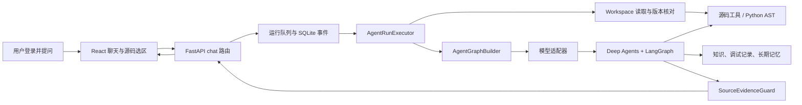

# ARKS 智能助手：系统整体分析

> 本文依据当前仓库代码和可重复执行的测试结果编写。源码、数据库和模型供应商的实际状态可能随本地配置变化；文中把“已实现”“本次新增”和“待核实”分开记录。

## 1. 项目是什么

ARKS 智能助手是一个运行在 Windows 本机上的源码交互与交接知识工作台。它把用户的对话、源码阅读、项目资料、调试问题和长期记忆放在同一个会话环境中，通过只读源码工作区回答“某个入口如何调用”“某个条件在哪里判断”“历史问题是否有相似记录”等问题。

当前后端是 Python 3.12、FastAPI 和 SQLAlchemy；前端是 React 19、TypeScript、Vite；Agent 运行基于 Deep Agents、LangGraph 和 LangChain 模型适配。当前被分析语言统一为 Python，使用标准库 `ast` 做只读静态分析；原 C#/Roslyn 路径已移除，`trunk/swe-agent/` 默认是 SWE-agent（NeurIPS 2024）的 Python 源码快照。

项目解决的核心问题是：业务源码规模大、交接资料分散、开发者需要在不修改和不执行业务源码的前提下快速找到实现证据，并将回答中的源码引用固定到文件版本和行号。

## 2. 使用者和使用方式

使用者是需要阅读、排查或交接业务源码的开发人员。服务默认只监听 `127.0.0.1:8765`，用户登录后选择项目和知识来源，在聊天框提问，或从文件树打开源码、选择代码后加入对话。源码目录只读，助手通过 `read_source`、`search_source`、符号工具和关系工具读取资料，再由模型组织回答。

应用还提供管理员工作区、账号隔离、长期记忆、调试问题录入、交接资料检索、备份恢复和模型配置。正式数据在本机 `data/`，不会由启动脚本自动上传到 GitHub。

## 3. 目录和关键文件

```text
ARKS-Assistant-master/
├─ backend/
│  ├─ app/main.py                 # ASGI 入口
│  ├─ app/bootstrap.py            # FastAPI、生命周期和模块路由装配
│  ├─ app/agents/                 # Agent 图、上下文、工具、提示词和执行器
│  ├─ app/modules/chat/           # 会话、消息、队列、运行恢复
│  ├─ app/modules/source_analysis/ # 源码边界、读取与 Python AST 分析
│  ├─ app/modules/knowledge/      # 资料、调试问题和语义检索
│  ├─ app/modules/memory/          # 长期记忆、冲突和版本状态
│  ├─ app/infrastructure/         # 数据库、模型供应商、MCP、备份
│  └─ tests/                      # pytest 单元、集成和架构测试
├─ frontend/src/                  # React 页面、状态、源码阅读器和交接工作台
├─ frontend/scripts/knowledge/    # 静态知识资源检查和构建
├─ resources/knowledge/           # 流程图谱、模块索引和生成资料
├─ scripts/dev/                   # Setup、Start、Stop 和本地服务管理
├─ skills/                        # 开发、结构和测试规范
├─ docs/                          # 架构、功能和验收文档
├─ trunk/                         # 被分析源码的大目录，子目录为各项目，只读
│  └─ swe-agent/                  # 默认项目：SWE-agent 快照
└─ data/                          # 本机数据库、账号、密钥和运行状态
```

最重要的文件是：

| 文件 | 作用 | 为什么重要 |
| --- | --- | --- |
| `backend/app/bootstrap.py` | 创建应用、注册路由和生命周期 | 决定服务如何装配，而不是业务模块互相启动 |
| `backend/app/agents/runtime/engine.py` | 组织一次 Agent 运行 | 把项目工作区、数据库、记忆、知识库和图构建器连接起来 |
| `backend/app/agents/runtime/graph_builder.py` | 创建 Deep Agents 图 | 组合模型、工具、文件后端、检查点和源码证据中间件 |
| `backend/app/agents/runtime/executor.py` | 排队、恢复、上下文准备和执行 | 处理断线恢复、上下文预算、源码选区和关系预取 |
| `backend/app/agents/tools/source.py` | 暴露源码读取、检索和语言工具 | 这是 Agent 与只读源码工作区的工具边界 |
| `backend/app/modules/source_analysis/workspace.py` | 路径、编码、版本、搜索和缓存 | 统一阻止越界、二进制读取和生成目录访问 |
| `backend/app/modules/source_analysis/python.py` | Python AST 分析 | 提供 Python 符号、导入、继承和保守调用关系 |
| `backend/app/modules/source_analysis/evidence.py` | 源码证据登记与引用复核 | 防止模型把未读取的代码写成已核实事实 |
| `backend/app/infrastructure/providers/models.py` | OpenAI/Anthropic/兼容供应商适配 | 统一模型配置、错误转译和用量记录 |
| `backend/app/infrastructure/database/` | SQLAlchemy、SQLite、检查点和数据存储 | 保存会话、运行事件、记忆和项目状态 |
| `frontend/src/features/source_reader/` | 文件树、编辑器、搜索和源码引用 | 将后端的只读文件能力呈现给用户 |
| `scripts/dev/Setup.ps1` / `Start.ps1` | 安装、构建、启动 | 是 Windows 本地运行的真实入口 |

## 4. 一次源码问答的执行链路



具体职责如下：

1. 前端通过项目 API 发送消息和源码选区；选区带路径、行号、内容快照和版本指纹。
2. `AgentRunExecutor` 在真正发送前重新读取选区，发现文件变化就标记为 stale，不把旧快照当作当前事实。
3. `Workspace` 对相对路径、符号链接、生成目录、文件大小和编码做边界检查，读取内容并计算 SHA-256 版本。
4. 当问题包含源码选区或源码问题时，执行器准备已读取的上下文；选中 `.py` 时调用 Python AST 关系分析。
5. `AgentGraphBuilder` 创建模型、源码工具、知识工具、记忆工具和只读 `/workspace/` 后端，并通过检查点保存图状态。
6. Agent 根据工具描述自主选择读取、搜索、关系分析和知识检索。工具返回的资料被作为资料，而不是用户指令。
7. `SourceEvidence` 登记实际读取的路径、行号和版本；回答中的 `source:path#Lx-Ly` 引用必须覆盖已登记范围。
8. `SourceEvidenceGuard` 在最终回答前做引用检查，必要时要求模型补读；无法核实的引用会被降级并明确提示。
9. 运行事件、模型用量、工具调用和源码证据写入 SQLite，前端通过事件流显示阶段、工具和结果。

## 5. 存储与外部服务

- SQLite 保存应用数据和 Agent 检查点；测试使用临时目录，不连接正式 `data/`。
- 模型通过 `ModelSettings` 选择 OpenAI Chat Completions、Anthropic Messages 或兼容供应商。密钥位于本机私有配置，接口只返回掩码。
- DeepWiki 通过 Streamable HTTP MCP 提供外部项目资料，连接失败时保留本地源码路径并显示降级提示。
- `resources/knowledge/` 是静态资料和生成索引，不等同于当前源码；源码版本核对仍以 `Workspace` 为准。

## 6. 现状边界

已经有证据的能力包括：本地只读源码读取、文本搜索、Python AST 结构与保守关系分析、模型工具调用、上下文压缩、记忆、知识检索、断线恢复和源码引用复核。

仍不能宣称的内容包括：模型回答必然正确、动态 Python 导入和运行时分派已经解析、业务设备动作已经发生、全项目所有模块已经人工读完，以及真实供应商在当前机器上始终可用。静态关系只代表源码中可推断的候选关系。
